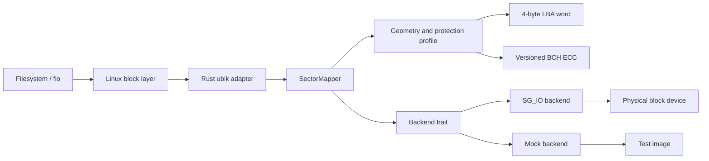

# sectorwrap

`sectorwrap` is a Rust userspace block-device wrapper for media whose physical
sector size is larger than the logical sector size expected by Linux.

The implementation is layered so the sector format and protection rules can be
tested without SCSI hardware.

## Protection layout

The logical payload is the largest 512-byte-aligned prefix. The remaining tail
is hidden from the user:

| Physical sector | Payload | Protection tail |
|---:|---:|---|
| 520 | 512 | 4-byte little-endian LBA + 4 bytes `ff` padding |
| 528 | 512 | 4-byte little-endian LBA + 12-byte BCH parity |
| 4224 | 4096 | 4-byte little-endian LBA + 124-byte BCH parity |

For a tail smaller than four bytes, the entire tail is filled with `ff`.
Profiles with at least 16 tail bytes use a versioned Reed-Solomon BCH profile
over GF(2^8), distributed across codewords below the 255-byte codeword limit.
The profile is internal and versioned; hardware-specific BCH polynomials can
be added without changing the mapping API.

An LBA mismatch is rejected as an addressing error. BCH corruption is corrected
when within the code's correction capability and rejected with an I/O error
otherwise. No corrupted sector is replaced with zeroes.

## Architecture



## Use sectorwrap (CLI)

`sectorwrap` is a command-line tool. Typical users should run the binaries, not
the Rust library crates directly.

### Dependencies

- Rust toolchain (`cargo`, `rustc`) on stable
- C toolchain with `cc` available
- `pkg-config`
- Linux kernel support for `ublk` and `io_uring` plus `/dev/ublk-control`
  (required for `sectorwrap-ublk`)
- Shared `libclang` library available at runtime/build time when building the
  `ublk` feature (bindgen requirement)
- SCSI generic device nodes (`/dev/sg*`) for real-device operation

### Build and install

Clone this repository

```sh
cd sectorwrap
```

Build release binaries:

```sh
cargo build --release --bin sectorwrap
cargo build --release --features ublk --bin sectorwrap-ublk
```

Install both binaries together:

```sh
sudo install -Dm755 target/release/sectorwrap /usr/local/bin/sectorwrap
sudo install -Dm755 target/release/sectorwrap-ublk /usr/local/bin/sectorwrap-ublk
```

Verify:

```sh
sectorwrap --help
sectorwrap-ublk --help
```

## Device manager

The main `sectorwrap` binary manages SCSI generic devices and their ublk
workers:

```sh
sudo sectorwrap status
sudo sectorwrap format /dev/sg0 /dev/sg2
sudo sectorwrap start /dev/sg0 /dev/sg2 /dev/sg6
sudo sectorwrap stop /dev/ublkb0
```

`status` probes every `/dev/sg*` device with SCSI `READ CAPACITY(16)` and
reports physical sector size, capacity, and active mappings. Native 512-byte
devices are supported as passthrough mappings; they do not receive synthetic
LBA/ECC metadata.

`format` is destructive. It writes every physical sector with a zero payload
and freshly generated protection data, then synchronizes the device cache. It
requires an interactive `y` confirmation:

```text
! WARNING POTENTIAL DATA LOSS !
Formatting Devices
   - /dev/sg0
Confirm? (y/N)
```

Use `--yes` only for explicitly controlled automation. Formatting is refused
for native 512-byte devices and devices currently managed by sectorwrap. The
current state file is `/run/sectorwrap/mappings`; it is updated atomically.
`start` waits for the corresponding `/dev/ublkbN` node before reporting
success, and `stop` waits for the worker to exit before removing the mapping.

### Real 528-byte SCSI device

The ublk adapter can use a SCSI generic device directly. This is destructive:
do not use the underlying `/dev/sdX` or `/dev/sg5` concurrently, and verify the
path before allowing writes.

```sh
sudo sg_inq /dev/sg5
sudo sg_readcap -l /dev/sg5
```

The capacity output must report a 528-byte logical block. Build the ublk
feature, then run it in the foreground:

```sh
sudo -E env \
  LIBCLANG_PATH=/usr/lib/llvm-*/lib \
  cargo run -p sectorwrap --features ublk --bin sectorwrap-ublk -- \
  --device /dev/sg5 \
  --sector-size 528 \
  --queues 4 \
  --depth 64
```

`READ CAPACITY(16)` determines the exposed size automatically. The process
creates a ublk device only after the reported physical sector size matches
`--sector-size`. In another terminal, identify the resulting device:

```sh
lsblk -o NAME,PATH,SIZE,LOG-SEC,PHY-SEC,TYPE,FSTYPE,MOUNTPOINTS
```

Before formatting, verify the target path carefully. Then create and mount an
ext4 filesystem on the ublk device (replace `/dev/ublkb0` with the actual
device shown by `lsblk`):

```sh
sudo mkfs.ext4 -F -b 4096 /dev/ublkb0
sudo mkdir -p /mnt/sectorwrap-test
sudo mount /dev/ublkb0 /mnt/sectorwrap-test
echo "sectorwrap hardware test" | sudo tee /mnt/sectorwrap-test/test.txt
sync
sudo cat /mnt/sectorwrap-test/test.txt
sudo umount /mnt/sectorwrap-test
```

Stop the foreground process with `Ctrl-C` after unmounting. Do not format the
underlying SCSI device directly: that would bypass sectorwrap's LBA and BCH
protection tail.

## License

The project is released under GPL-3.0-or-later. Source files carry the SPDX
identifier `GPL-3.0-or-later`.
